  

  
  
  

## 👋 About me

- 💻 **C# Windows & Web App developer** at **Marunix (Cambodia)**
- 📍 Based in **Phnom Penh, Cambodia** 🇰🇭
- 🧾 I build **POS systems, management systems and business web apps**
- 🌱 Always learning — currently leveling up in **.NET, TypeScript and clean architecture**
- 🤝 Open to collaborating on useful, real-world projects
- ⚡ Fun fact: I run on coffee and `Ctrl + S`

  

## 🛠️ Tech stack

  

## 🚀 Featured projects

| Project | Description | Tech |
|---|---|---|
| [AiPOSSystem](https://github.com/MrPhanun/AiPOSSystem) | Point-of-sale system | TypeScript |
| [L-Or-de-Cambodge-System](https://github.com/MrPhanun/L-Or-de-Cambodge-System) | Suit management system | JavaScript |
| [QCWebTabletApp](https://github.com/MrPhanun/QCWebTabletApp) | Quality-control web app for tablets | JavaScript |
| [TongTinWeb](https://github.com/MrPhanun/TongTinWeb) | Web application | C# |
| [MC-Dept-App](https://github.com/Rachhan-BRC/MC-Dept-App) | MC department app | C# |
| [WEB-CV](https://github.com/MrPhanun/WEB-CV) | My online CV | CSS |

## 📊 GitHub stats

  
  

  

## 🐍 Contribution snake

  <picture>
    <source media="(prefers-color-scheme: dark)" srcset="https://raw.githubusercontent.com/MrPhanun/MrPhanun/output/github-snake-dark.svg" />
    
  </picture>

  

