 

 

### ✦ tl;dr

- 🧾 **I build real stuff for real businesses** — POS, management systems, internal web apps
- 🏢 Shipping C# Windows & Web apps at **Marunix (Cambodia)**
- 🌱 Leveling up in **.NET, TypeScript & clean architecture**
- 🤝 Down to collab on useful, real-world projects — ping me

 

### ✦ stack

  
   
  

 

### ✦ currently

| 🔨 building | 📚 learning | 🎧 vibe |
| :-- | :-- | :-- |
| POS & management systems | .NET deep dives, TypeScript | coffee → code → `Ctrl + S` → repeat |

 

### ✦ featured work

| project | what it is | built with |
| :-- | :-- | :-- |
| [**AiPOSSystem**](https://github.com/MrPhanun/AiPOSSystem) | Point-of-sale system |  |
| [**L-Or-de-Cambodge-System**](https://github.com/MrPhanun/L-Or-de-Cambodge-System) | Suit management system |  |
| [**QCWebTabletApp**](https://github.com/MrPhanun/QCWebTabletApp) | Quality-control web app for tablets |  |
| [**TongTinWeb**](https://github.com/MrPhanun/TongTinWeb) | Web application |  |
| [**MC-Dept-App**](https://github.com/Rachhan-BRC/MC-Dept-App) | MC department app |  |
| [**WEB-CV**](https://github.com/MrPhanun/WEB-CV) | My online CV |  |

 

### ✦ stats

  
  
   
  

 

  <picture>
    <source media="(prefers-color-scheme: dark)" srcset="https://raw.githubusercontent.com/MrPhanun/MrPhanun/output/github-snake-dark.svg" />
    
  </picture>

 

  built with ☕ in Phnom Penh · thanks for scrolling this far ✌️

